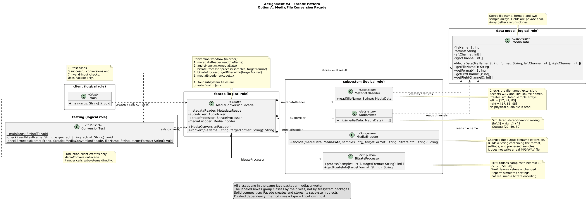

# Assignment 4 | Facade Pattern

**Student:** Irangait Yerassyl  
**Group:** SE-2523  
**Course:** Software Design Patterns  
**Topic:** Option A - Media/File Conversion Facade  
**Language:** Java 17

## Project Overview

This project demonstrates the **Facade Design Pattern** through a simulated media conversion system. The client provides a source file name and a target format (WAV or MP3). The `MediaConversionFacade` coordinates the conversion steps behind one simple method:

```java
public String convert(String fileName, String targetFormat)
```

The application uses **simulated audio samples**, not real audio decoding or encoding. It does not create physical MP3/WAV files. The purpose is to demonstrate how one Facade simplifies access to several collaborating subsystem classes.

## Role Map

| Role | Class | Source |
|---|---|---|
| Client | `Main` | `src/mediaconverter/Main.java` |
| Facade | `MediaConversionFacade` | `src/mediaconverter/MediaConversionFacade.java` |
| Subsystem 1 | `MetadataReader` | `src/mediaconverter/MetadataReader.java` |
| Subsystem 2 | `AudioMixer` | `src/mediaconverter/AudioMixer.java` |
| Subsystem 3 | `BitrateProcessor` | `src/mediaconverter/BitrateProcessor.java` |
| Subsystem 4 | `MediaEncoder` | `src/mediaconverter/MediaEncoder.java` |
| Data model | `MediaData` | `src/mediaconverter/MediaData.java` |
| Test client | `ConversionTest` | `src/mediaconverter/ConversionTest.java` |

All Java classes are in the `mediaconverter` package.

## Facade Structure

`Main` creates only the `MediaConversionFacade`. The four subsystem objects are created in the Facade constructor and stored in `private final` fields. The client does not instantiate or call subsystem classes directly.

The `convert()` method coordinates the workflow in this order:

1. `MetadataReader.read(fileName)` checks the file name and source format, then creates `MediaData`.
2. `AudioMixer.mix(mediaData)` combines the left and right sample arrays into one channel.
3. `BitrateProcessor.process(mixedSamples, targetFormat)` applies the simulated target-format processing.
4. `BitrateProcessor.getBitrateInfo(targetFormat)` returns the simulated output settings.
5. `MediaEncoder.encode(...)` forms the final text result with the output file name and processed samples.

Subsystem classes do not depend on the Facade and can still be used separately.

## UML Class Diagram

The diagram includes the client, Facade, subsystem classes, data model, test client, and their relationships.



## Build and Run

### IntelliJ IDEA

1. Open the project in IntelliJ IDEA.
2. Set the project SDK to **JDK 17**.
3. Run `main()` in `src/mediaconverter/Main.java` to see the conversion demonstration.
4. Run `main()` in `src/mediaconverter/ConversionTest.java` to run all 10 test cases.

### Windows PowerShell (optional)

Run these commands from the project root:

```powershell
New-Item -ItemType Directory -Force out | Out-Null
javac --release 17 -encoding UTF-8 -d out (Get-ChildItem .\src\mediaconverter\*.java | ForEach-Object { $_.FullName })
java -cp out mediaconverter.Main
java -cp out mediaconverter.ConversionTest
```

No third-party libraries or build tools are required.

## Expected Demonstration Result

With `facade.convert("song.wav", "mp3")`, the expected console output is:

```text
File: song.mp3
Format: MP3
Settings: 128 kbps (simulated)
Samples: 20,50,90
```

For WAV output, the simulated sample values remain `[22, 50, 89]`. For MP3 output, the values are rounded to the nearest ten, producing `[20, 50, 90]`.

## Test Scenarios

`ConversionTest` includes **10 checks**:

- 3 successful cases: WAV to MP3, MP3 to WAV, and input normalization (uppercase extensions and extra spaces).
- 7 invalid-input cases: unsupported source format, missing extension, unsupported target format, blank file name, blank target format, null file name, and null target format.

The expected final summary after a successful test run is:

```text
All 10 tests passed.
```

## Limitations

The conversion is simulated for the design-pattern assignment. `MetadataReader` creates fixed sample arrays, `AudioMixer` averages two channels, `BitrateProcessor` performs simple numerical processing, and `MediaEncoder` produces a text result. **No actual media file is read, encoded, or written.**
